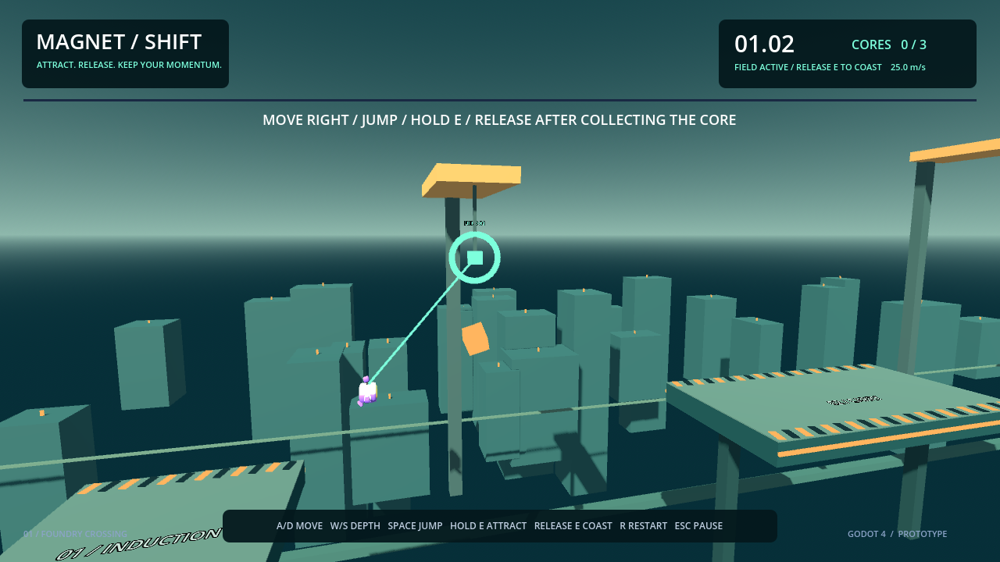

# Magnet Shift

A small **Godot 4.7.2 / GDScript** prototype about magnetic attraction and release timing. Pull toward a selected anchor, release to retain momentum, recover three cores and reach the receiver.



## Play

**[Download Windows build (v1.2)](https://github.com/EtherestQQ/magnet-shift/releases/download/v1.2/MagnetShift-Windows-v1.2.zip)** · [Release notes and checksums](https://github.com/EtherestQQ/magnet-shift/releases/tag/v1.2)

Extract the ZIP, then open `MagnetShift.exe`. Godot is not required to play.


Open `MagnetShift.exe` in the Windows build. For source, import `project.godot` in Godot 4.7.2 and press F5. The course is constructed at runtime.

- **A/D:** move left/right. **W/S:** adjust depth. **Space:** jump; there is no double jump.
- **Hold E:** attach to a highlighted anchor in range and line of sight. Holding E early will attach when a target becomes valid.
- **Release E:** stop attraction and carry the current velocity. This is radial force, not a rope or teleport.
- **A/D in the air:** limited steering. After a core, release E and hold A to brake toward the next platform. A long hold or late release may overshoot.
- **R:** restart the run. Falling resets the whole run. **Escape:** pause/resume; restart also works while paused.
- Collect all **three orange cores**, then enter the mint receiver frame at the far right. **They are required to unlock the exit.** The objective stays visible at the top, and the locked receiver shows how many are missing. Airborne entry is valid.

The latched anchor stays fixed while held; range/obstructions can detach it. If E remains held after a forced loss, another valid selected target can be acquired. Only the actual current target is highlighted while latched. Solid foreground gantries block targeting and collide with the player. Background skyline blocks are decorative.

The course is deliberately small: a practiced automated run takes about nine seconds. Human attempts may take multiple restarts. It is a movement experiment, not a full game.

## Runtime safeguards (v1.2)

The game caps rendering at 60 FPS and reduces it to 15 FPS when unfocused. New builds reserve a localhost-only port (43761) to prevent another guarded copy from staying open; old v1.0/v1.1 executables do not implement this guard. A busy port also closes the new copy. These safeguards reduce avoidable load; they do not prove the reported laptop freeze is fixed.

## Implementation

- `magnet/player.gd`: acceleration-based controller, range/line-of-sight selection, grounded jump with grace/buffer, radial field, exact release-state preservation.
- `magnet/course.gd`: three-gap course, gantries/colliders, beam, camera, receiver, timer and sound.
- `magnet/power_core.gd`: physics-triggered, single-count pickup and restart.
- `magnet/hud.gd`: readable field/speed state; always-active pause/restart controls and reduced motion.

The magnetic field adds `direction * force * delta` to velocity, softened within two meters of the target. Releasing clears the anchor reference without modifying velocity. Gravity, limited air steering and a terminal speed still act afterward. This preserves launch momentum but is not a general rigid-body rope simulation.

The level is built at runtime, so the editor initially shows its root node. Inspect the Remote scene tree while playing. Tunable movement values are exported on the player; deck and anchor positions are constants in the course.

## Verify

Run from this folder with Godot on PATH:

```text
godot --headless --path . --script res://tests/test_runtime.gd
godot --headless --path . --script res://tests/test_controller.gd
godot --headless --path . --script res://tests/test_course.gd
godot --headless --path . --script res://tests/replay.gd --fixed-fps 60
```

Controller tests cover attraction, release velocity, out-of-range and blocked targets, early-held E, anchor-surface visibility and reset. Course tests cover actual pickup overlaps, duplicate pickup, reset, pause/keyboard resume/restart, solid gantries and airborne receiver entry. The replay traverses all three gaps via input/physics: no teleport or direct velocity overrides during traversal. Its automatic braking is not a human game-feel evaluation.

For a Windows rebuild, install matching official 4.7.2 export templates and run:

```text
godot --headless --path . --export-release "Windows Desktop" ../MagnetShift-Windows/MagnetShift.exe
```

## Attribution and limits

A compact Godot movement prototype, separate from Aether Dash and the employer's checkpoint test.

Character mesh/animation and sound assets come from [Kenney's Starter Kit 3D Platformer](https://github.com/KenneyNL/Starter-Kit-3D-Platformer), CC0 assets. The upstream source license is preserved in `LICENSE-Kenney.md`. Controller, attraction, course and tests are new work; HUD helpers were adapted from the first AI-assisted prototype.

Keyboard only, fixed-heading camera, one compact course. No rebinding, gamepad support, checkpoints, music, account or online services. Reduced motion disables speed-driven FOV changes. Foreground geometry is solid; distant scenery is not. No best-time persistence is included. Human playtesting is still needed.
